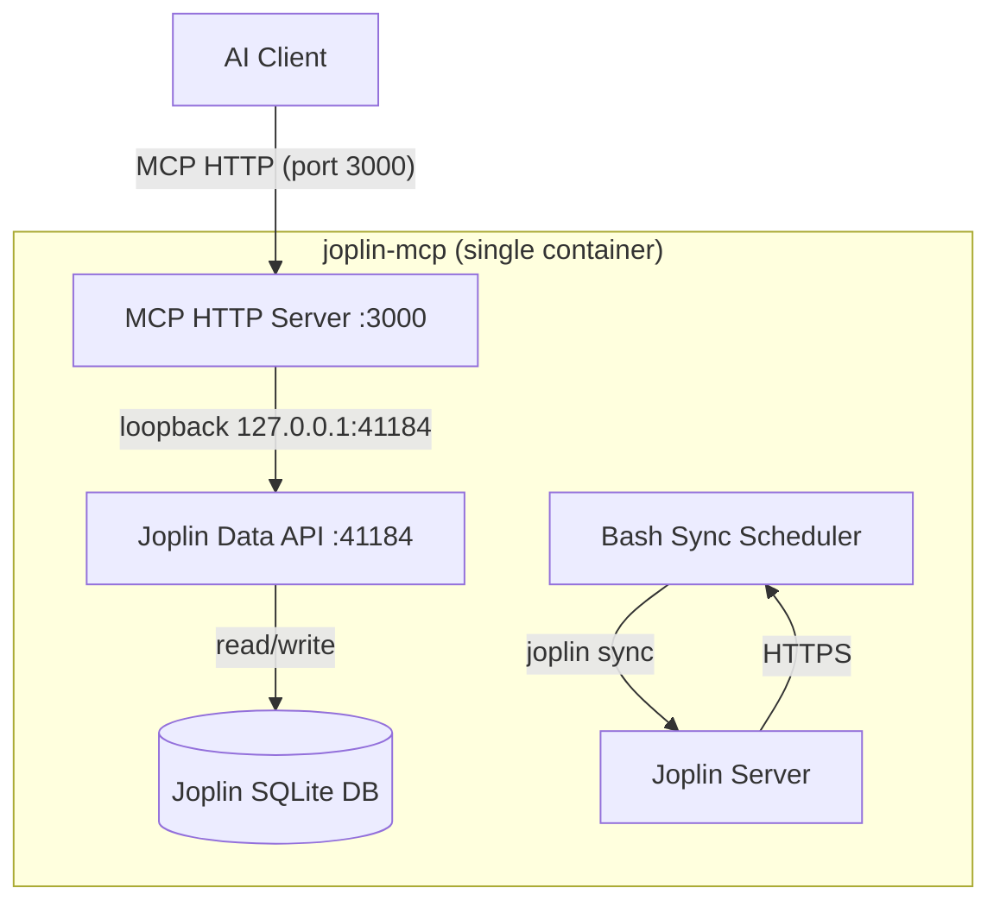

# Architecture

Reader: a developer or operator evaluating how the `joplin-mcp` container is put together — what runs inside it, how the components communicate, and what happens at startup and shutdown.

## Single-container topology

One container runs everything: the Joplin CLI with its Data API (loopback-only), a bash periodic-sync loop, and the Node.js MCP HTTP server.

## Component map

| Component | Where it runs | Role |
| --------- | ------------- | ---- |
| MCP HTTP server | port 3000 (`node /app/dist/mcp/entry.js`, [`entrypoint-combined.sh:1139`](entrypoint-combined.sh:1139)) | Serves the 17 MCP tools over StreamableHTTP; the only published port |
| Joplin Data API | `127.0.0.1:41184` inside the container (`joplin server start`, [`entrypoint-combined.sh:645`](entrypoint-combined.sh:645)) | Structured HTTP read/write access to the Joplin SQLite database |
| Bash sync scheduler | own process group via `setsid` ([`entrypoint-combined.sh:1053`](entrypoint-combined.sh:1053)) | Runs flock-serialized `joplin sync` every `SYNC_INTERVAL_SECONDS` (default 300) against Joplin Server |

Supporting properties of the image ([`Dockerfile.combined`](Dockerfile.combined)):

- Multi-stage build on `node:22-bookworm-slim` with separate build and production stages ([`Dockerfile.combined:11`](Dockerfile.combined:11), [`Dockerfile.combined:31`](Dockerfile.combined:31))
- Non-root user `joplin` (uid 1001) for all processes ([`Dockerfile.combined:54`](Dockerfile.combined:54))
- Persistent volume `joplin_data` mounted at `/home/joplin/.config/joplin` stores the Joplin profile and SQLite database
- The MCP server reaches the Data API over loopback (`127.0.0.1:41184`) — no network proxy, no Docker-internal networking ([`entrypoint-combined.sh:21-23`](entrypoint-combined.sh:21))
- Write operations persist to the local Data API and reach Joplin Server on the next scheduled sync (see [`docs/sync.md`](docs/sync.md))

## Why a single container

Three decisions shape the topology:

1. **Data API over CLI for data operations** — tool calls use the structured HTTP API with typed responses instead of fragile CLI output parsing.
2. **All components in one container** — Data API, sync scheduler, and MCP server communicate over loopback (`127.0.0.1:41184`), which eliminates cross-container networking and the socat proxy of the former two-container setup; only port 3000 is published.
3. **Bash-based sync scheduler** — a plain `while true` loop replaces the TypeScript `SyncManager` as the sole sync mechanism; it logs every sync with PASS/FAIL to `/var/log/joplin/sync.log` ([`entrypoint-combined.sh:55-64`](entrypoint-combined.sh:55)).

## Healthcheck

The image healthcheck probes **three** legs with `--interval=30s --timeout=10s --retries=3 --start-period=120s` ([`Dockerfile.combined:86-87`](Dockerfile.combined:86)):

1. `GET http://127.0.0.1:41184/ping` — the Data API answers
2. `GET http://127.0.0.1:3000/health` — the MCP server answers
3. **Fail-closed E2EE probe** — only when `JOPLIN_MASTER_PASSWORD` is set: a read-only SQLite probe counts rows with non-empty `encryption_cipher_text`; any non-zero count or a probe failure marks the container unhealthy

The `start-period=120s` budget exists because the initial sync (and, with E2EE, the post-sync decrypt) runs before the MCP server starts — a fresh container with a large library can legitimately stay without a `/health` endpoint for minutes. See [`docs/sync.md#initial-sync-throughput`](docs/sync.md#initial-sync-throughput).

The healthcheck probes the default ports only; it does not honour a `JOPLIN_DATA_API_PORT` override ([`Dockerfile.combined:85`](Dockerfile.combined:85)).

## SQLITE_BUSY and sync safety (summary)

The Data API and `joplin sync` share one SQLite database. When the Data API holds the write lock, a concurrent sync can receive `SQLITE_BUSY` and misread the database version as `null`, triggering destructive schema migrations from version 0. The container cannot prevent the first such sync without upstream changes, so it provides **damage limitation**: detection of destructive log signatures, a persistent halt marker, a deletion circuit-breaker, and flock serialization of all syncs. The full mechanics, the dangerous log patterns, and recovery steps live in [`docs/sync.md#sqlite_busy-and-damage-limitation`](docs/sync.md#sqlite_busy-and-damage-limitation).

## Startup pipeline

The entrypoint ([`entrypoint-combined.sh`](entrypoint-combined.sh)) executes these steps in order:

1. **Validate environment** — requires `JOPLIN_SERVER_URL`, `JOPLIN_USERNAME`, `JOPLIN_PASSWORD` ([`entrypoint-combined.sh:559-572`](entrypoint-combined.sh:559))
2. **Configure the Joplin CLI** — sets `sync.target 10` and server credentials; when `JOPLIN_MASTER_PASSWORD` is set, also configures the E2EE master password ([`entrypoint-combined.sh:604-621`](entrypoint-combined.sh:604))
3. **Start the Data API** — `joplin server start` binding to `127.0.0.1:41184`, before the initial sync ([`entrypoint-combined.sh:641-647`](entrypoint-combined.sh:641))
4. **Extract the API token** — honours a pre-set `JOPLIN_API_TOKEN`, otherwise auto-extracts from the CLI config / `settings.json` with retries ([`entrypoint-combined.sh:694-727`](entrypoint-combined.sh:694))
5. **Wait for readiness** — polls `/ping` up to 30 times, 2 s apart ([`entrypoint-combined.sh:652-684`](entrypoint-combined.sh:652))
6. **Perform the initial sync** — flock-serialized `joplin sync` with error and destructive-signature diagnostics; a detected danger writes a halt marker and skips the periodic loop ([`entrypoint-combined.sh:751-796`](entrypoint-combined.sh:751))
7. **Decrypt E2EE items** — only when `JOPLIN_MASTER_PASSWORD` is set: a master-key preflight halts with `[E2EE_NO_MASTER_KEY]` when no master key exists after the sync; otherwise `joplin e2ee decrypt --force` runs with bounded retries, failing closed with `[E2EE_DECRYPT_FAIL]` ([`entrypoint-combined.sh:799-932`](entrypoint-combined.sh:799))
8. **Verify decryption** — a read-only SQLite probe must count zero remaining encrypted items, fail-closed with `[E2EE_DECRYPT_INCOMPLETE]`, or the periodic loop does not start ([`entrypoint-combined.sh:982-1011`](entrypoint-combined.sh:982))
9. **Start the periodic sync loop** — bash `while true` in its own process group, gated on the `.sync-halt` marker before each sync ([`entrypoint-combined.sh:1052-1062`](entrypoint-combined.sh:1052))
10. **Start the MCP HTTP server** — `node /app/dist/mcp/entry.js` on port 3000, deliberately last ([`entrypoint-combined.sh:1138-1140`](entrypoint-combined.sh:1138))
11. **Liveness monitor** — `wait -n` on both child PIDs; if either dies the entrypoint logs which one, runs cleanup, and exits non-zero so Docker's restart policy applies ([`entrypoint-combined.sh:1282-1288`](entrypoint-combined.sh:1282))
12. **Handle signals** — on `SIGTERM`/`SIGINT` the trap runs the shutdown pipeline below and exits ([`entrypoint-combined.sh:1278-1279`](entrypoint-combined.sh:1278))

## Shutdown pipeline

On `SIGTERM`/`SIGINT`, `cleanup()` ([`entrypoint-combined.sh:1155-1273`](entrypoint-combined.sh:1155)) runs four ordered stages:

1. **Kill the sync loop group** — the loop runs in its own process group, so the whole group (including any in-flight `joplin sync`) is drained with a 10 s bound, escalating to `SIGKILL` ([`entrypoint-combined.sh:1165-1184`](entrypoint-combined.sh:1165))
2. **Stop the MCP server** — `SIGTERM` with an 8 s grace period, then `SIGKILL` ([`entrypoint-combined.sh:1189-1203`](entrypoint-combined.sh:1189))
3. **Stop the Data API** — `SIGTERM`, 3 s grace, then `SIGKILL`; SQLite gets a clean-close window ([`entrypoint-combined.sh:1206-1230`](entrypoint-combined.sh:1206))
4. **Final sync** — one last flock-serialized `joplin sync`, skipped when the Data API already died or a halt marker exists; the final sync passes the same danger checks and deletion circuit-breaker as every other sync ([`entrypoint-combined.sh:1235-1270`](entrypoint-combined.sh:1235))

## Where to read next

- Sync modes, SQLITE_BUSY damage limitation, and halt-marker recovery: [`docs/sync.md`](docs/sync.md)
- E2EE master password handling and the fail-closed decrypt gates: [`docs/e2ee.md`](docs/e2ee.md)
- Token handling, TLS, and CLI hardening: [`docs/security.md`](docs/security.md)
- Local commands and project layout: [`docs/development.md`](docs/development.md)
